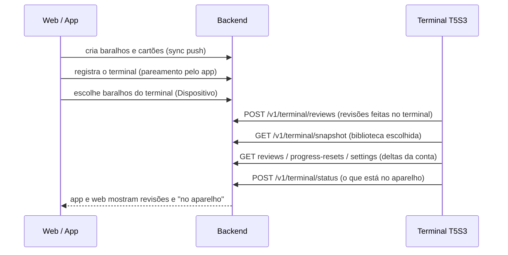

# Terminal T5S3 Pro na plataforma Mnemos — integração e demonstração local

Firmware `0.8.2-preview.1-t5s3-pro`. Este documento descreve como o terminal
conversa com o backend, o app e a web, o que foi corrigido para que tudo
funcione como uma plataforma só, e como montar uma demonstração 100% local.

## 1. Como o terminal participa da plataforma

O terminal não fala com o app nem com a web diretamente. Todos falam com o
backend, que é a fonte da verdade da conta:



Uma rodada de sincronização faz, nessa ordem: envia revisões pendentes, baixa
o snapshot dos baralhos escolhidos, puxa revisões de outros aparelhos, resets
de progresso e a retenção desejada, e reporta o estado físico.

### Quando o terminal sincroniza sozinho

| Gatilho | Quando |
| --- | --- |
| Boot | assim que o Wi-Fi conecta depois de ligar |
| Wi-Fi conectou | toda vez que a rede volta (se a última sync tem mais de 1 min ou há revisões pendentes) |
| Pareamento | logo depois que o app grava rede e credencial |
| Fim de sessão | ao sair do resumo, se há revisões pendentes (o rádio é religado se estava desligado) |
| Periódica | a cada 5 min (bancada) ou 15 min (produto) com o Wi-Fi ativo, fora das telas de estudo (o rádio desliga após 3 min sem uso e volta nos gatilhos acima) |
| Manual | Sincronização → "Sincronizar com a conta", ou `mnemos_demo.py sync` |

A sincronização nunca roda no meio de uma sessão de estudo. Sem rede, o estudo
continua normalmente e as revisões ficam na fila (outbox) até a próxima rodada.

## 2. O que mudou no firmware

### Pareamento com o app (antes não funcionava)

- **QR no formato que o app lê.** O leitor do app só aceita `mnemos://pair?...`;
  o firmware gerava `mnemos://local?...`, que era ignorado.
- **QR dentro da capacidade.** O QR é desenhado na versão 8 (até 192 bytes). O
  payload antigo no modo rede temporária tinha 195 bytes e saía corrompido sem
  aviso. O campo `transport` (não usado pelo app) saiu; o payload agora tem
  ~181 bytes. Validado decodificando os QRs gerados pela mesma biblioteca.
- **Sempre a rede temporária (SoftAP).** O app sempre entra na rede indicada
  no QR. Quando o terminal já estava no Wi-Fi, o QR apontava a rede da casa com
  senha vazia e o Android tentava uma rede aberta. Agora o terminal abre o
  SoftAP em modo AP+STA, preservando a conexão atual.
- **Reprovisionar o Wi-Fi não apaga o pareamento.** Se o app não conseguir
  registrar o terminal (servidor fora, endereço `localhost`), a rede é gravada
  e a credencial anterior é mantida.
- `/v4/info` informa `deckIds` (o app usa como "no aparelho" logo após parear)
  e `backendPaired`.
- "Sincronizar com o celular" passou a abrir o QR de pareamento: o app atual
  sincroniza com o terminal pela conta, não por Wi-Fi direto.

### Sincronização robusta

- **Revisões recusadas não travam mais a fila.** Antes, uma única revisão de
  cartão apagado no app fazia o backend responder 403 ao lote inteiro, para
  sempre. Agora o terminal separa as revisões citadas no 403 (cartões apagados
  ou de outra conta) e, no 422, isola a revisão problemática enviando uma a
  uma. Recusas definitivas vão para `/review_rejected.ndjson` com o motivo.
- **Prática livre não sobe.** Sessões de prática não alteram o agendamento no
  terminal, mas iam para o backend como revisões normais e mudavam o
  agendamento no app e na web. Agora ficam só no histórico local (§5.2 do
  contrato).
- **Revisões com relógio inválido** (antes de 2023) vão para a quarentena em
  vez de bagunçar o replay FSRS das outras plataformas.
- **Envio em lotes de 40** (o backend aceita até 500 por requisição).
- **IDs UUIDv7** nas revisões, o mesmo formato de app e web.
- **Snapshot tolerante.** Um cartão inválido ou de tipo não suportado é
  ignorado (e contado) em vez de recusar a biblioteca inteira; verso vazio
  vira "(sem resposta cadastrada)".
- **Texto normalizado para o e-paper.** As fontes cobrem Latin-1/Extended-A e
  um subconjunto CJK. Aspas tipográficas, travessões, setas, letras gregas,
  índices (H₂O), símbolos matemáticos, emoji e acentos decompostos (NFD) são
  convertidos (`→` vira `->`, `θ` vira `teta`, `≤` vira `<=`, emoji somem). Sem
  isso, cartões criados pela IA apareciam cheios de `?`.
- **Sincronização sem mudanças não regrava nada.** Ids, revisões e baralhos
  iguais: nada é gravado no LittleFS/microSD e a tela não pisca.
- **Biblioteca local preservada.** Um snapshot vazio (conta ainda sem baralhos
  escolhidos para o terminal) não apaga cartões importados do microSD. Quando
  a conta escolhe baralhos, eles substituem a biblioteca.
- **Status sem erro 500.** O backend responde 500 se recebe um baralho que não
  é da conta; o terminal só reporta baralhos vindos do backend (e reenvia sem
  a lista se ainda assim falhar). Limites de 32 baralhos e SSID de 32
  caracteres respeitados.
- **Deltas em lote.** Antes, cada revisão recebida relia e reinterpretava o
  histórico inteiro (quadrático: minutos para algumas centenas de revisões,
  como as do `SEED_DEMO` do app). Agora o histórico é lido uma vez por página e
  as linhas novas são gravadas numa única abertura de arquivo.
- **Troca de conta ou servidor reinicia os cursores** (sem duplicar eventos).
- **409 de capacidade** vira mensagem clara; revisões continuam sendo trazidas.
- **401** (terminal revogado/de outra conta) para as tentativas automáticas
  até um novo pareamento.
- **HTTPS pronto para o staging.** Raízes ISRG Root X1, X2 e YE embutidas (as
  que o README do Lightsail pede). `BACKEND_ROOT_CA` e `/backend_ca.pem`
  continuam tendo precedência. Uma conexão por rodada (keep-alive), sem um
  handshake TLS por requisição.
- **Relógio pelo servidor.** Sem internet não há NTP: o terminal usa o
  cabeçalho `Date` do backend quando o relógio não é confiável.
- **Nomes `.local` (mDNS)** na URL do backend: `http://meu-notebook.local:8000`
  funciona mesmo se o IP do notebook mudar.

### Telas

- "Sincronizar com a conta" conecta o Wi-Fi se preciso (até 15 s), mostra
  "Sincronizando…" e depois o resultado: cartões no terminal, revisões
  enviadas e recebidas, ou a causa da falha (sem rede, servidor inacessível,
  credencial recusada, biblioteca grande demais, HTTPS…).
- Biblioteca vazia ao tocar em Estudar: explica como escolher baralhos.
- Depois do pareamento: confirma rede e conta gravadas.

### Console serial (USB, 115200)

Uma linha JSON por comando; respostas começam com `@mnemos `.

```text
{"cmd":"info"}
{"cmd":"provision","ssid":"Rede","password":"senha123","backendUrl":"http://192.168.0.10:8000","deviceToken":"..."}
{"cmd":"wifi","ssid":"Rede","password":"senha123"}
{"cmd":"backend","url":"http://notebook.local:8000","token":"..."}
{"cmd":"sync"}
{"cmd":"time","epoch":1763730000}
{"cmd":"unpair","newIdentity":true}
{"cmd":"reboot"}
```

O backend vincula um id de terminal a uma conta para sempre (mesmo revogado).
`unpair` com `newIdentity` troca o id (`T5S3-ABCDEF` → `T5S3-ABCDEF-1`) para
parear com outra conta.

## 3. Demonstração local (sem nuvem)

### Arquitetura sugerida

```text
        roteador portátil / hotspot 2,4 GHz WPA2  (ex.: rede "Mnemos-Demo")
          │                 │                         │
   notebook (Docker)    celular Android          terminal T5S3
   backend :8000        app (API_BASE_URL=        firmware 0.8.2
   web     :4200        http://IP-do-notebook:8000)
```

Por que uma rede própria: redes de universidade costumam isolar os clientes
(o terminal não alcança o notebook) e usar WPA2-Enterprise. Um roteador de
viagem ou o hotspot de um segundo celular resolvem; o hotspot do próprio
notebook também serve (Windows: Hotspot móvel, IP 192.168.137.1; Linux:
`nmcli dev wifi hotspot`, IP 10.42.0.1). O terminal só enxerga 2,4 GHz.

Dica: reserve o IP do notebook no DHCP do roteador. O app passa ao terminal a
mesma URL com que foi compilado; se o IP mudar, use `mnemos_demo.py pair` de
novo (ou `{"cmd":"backend",...}` com `http://<hostname>.local:8000`).

### Passo a passo

1. **Backend** (na raiz do repositório):

   ```bash
   cp backend/.env.example .env          # opcional; os padrões já servem
   # para geração por IA, preencha ANTHROPIC_API_KEY (precisa de internet)
   # para uploads do celular, S3_PUBLIC_ENDPOINT_URL=http://IP-do-notebook:9000
   docker compose up -d
   docker compose run --rm migrate
   ```

   Libere a porta 8000 no firewall do notebook.

2. **Conferir** (descobre o IP e testa o backend):

   ```bash
   pip install pyserial
   python3 firmware/t5s3-pro/tools/mnemos_demo.py doctor --api http://IP-do-notebook:8000
   ```

3. **App** (celular físico; o emulador não alcança o terminal):

   ```bash
   cd app/mobile
   flutter run --release --dart-define=API_BASE_URL=http://IP-do-notebook:8000
   # opcional: --dart-define=SEED_DEMO=true traz cartões e histórico de exemplo
   ```

   Abra o app uma vez com o backend no ar: ele cria a conta (anônima) do aparelho.

4. **Uma conta só para app, web e terminal.** O app não tem tela de login: a
   conta dele é anônima, presa ao aparelho. Dê e-mail e senha a essa conta:

   ```bash
   python3 firmware/t5s3-pro/tools/mnemos_demo.py link-app --api http://IP:8000 \
       --email demo@mnemos.dev --password mnemos-demo
   ```

   O comando acha o aparelho mais recente no banco local (via `docker compose`)
   e só acrescenta credenciais: nada é movido. Funciona em desenvolvimento e
   no staging (attestation desligada). Use um e-mail que ainda não exista; se
   você já criou uma conta na web, ela é outra conta.

5. **Web**: `cd app/web && npm ci && npm start` → <http://localhost:4200>,
   entre com o e-mail do passo 4. Para ter conteúdo pronto:

   ```bash
   python3 firmware/t5s3-pro/tools/mnemos_demo.py seed --api http://IP:8000 \
       --email demo@mnemos.dev --password mnemos-demo
   ```

6. **Terminal**: grave o firmware (`pio run -e t5s3-pro-bench -t upload`).
   Pareie de um destes jeitos (os dois põem o terminal na mesma conta):
   - **Pelo app**: Dispositivo → Conectar um Mnemos → leia o QR do terminal em
     Menu → Conexão → Configurar pelo celular → escolha a rede da demo.
   - **Pelo cabo USB** (plano B, não depende do app):

     ```bash
     python3 firmware/t5s3-pro/tools/mnemos_demo.py pair --api http://IP:8000 \
         --email demo@mnemos.dev --password mnemos-demo \
         --ssid Mnemos-Demo --wifi-password senha123 --decks all
     ```

     Se aparecer "pertence a outra conta", acrescente `--new-identity`.

7. **Baralhos do terminal**: web → Dispositivo (ou app → Dispositivo) →
   ligue os baralhos. O terminal aplica na próxima sincronização; para mostrar
   na hora, toque em Sincronização → Sincronizar com a conta.

### Roteiro de apresentação (≈ 5 min)

1. Web: criar um cartão (ou gerar com IA) num baralho já marcado para o terminal.
2. Terminal: Sincronizar com a conta → "Sincronizado: N cartões" → o cartão novo aparece.
3. Terminal: estudar 3–4 cartões e voltar à tela inicial (a sincronização dispara sozinha).
4. Web/app: o progresso mostra as revisões; Dispositivo mostra "Sincronizado agora há pouco".
5. App: estudar outro cartão → terminal sincroniza → a agenda do terminal reflete a revisão feita no celular.
6. Web: editar o texto de um cartão → terminal sincroniza → texto novo.
7. Offline: desligue o roteador, estude no terminal, religue → a fila esvazia sozinha.
8. (Opcional) `mnemos_demo.py monitor` num terminal do notebook mostra o log `[backend] sync ...` ao vivo.

### Staging (Lightsail, HTTPS)

Compile o app com `API_BASE_URL=https://mnemos.<ip-com-hífens>.sslip.io` e
pareie normalmente. As raízes Let's Encrypt já estão no firmware.

## 4. Testes

- `tools/host_sync/run.sh`: compila no PC o código real de sincronização do
  firmware e roda 31 verificações ponta a ponta contra o backend (veja o
  README da pasta). Passou contra o backend da `main` (Postgres 16).
- O firmware compila nos ambientes `t5s3-pro-bench` e `t5s3-pro`
  (espressif32 6.5.0 / Arduino 2.0.14).

## 5. Solução de problemas

| Sintoma | Causa provável | O que fazer |
| --- | --- | --- |
| App não reconhece o QR | firmware antigo (QR `local` / payload corrompido) | gravar o 0.8.2 |
| "Rede gravada" sem conta após parear | app compilado com `localhost`/`10.0.2.2` ou backend inacessível pelo celular | recompilar o app com o IP do notebook; ou `mnemos_demo.py pair` |
| "Servidor inacessível" | IP mudou, firewall, isolamento de clientes | `doctor`; liberar porta 8000; rede própria |
| "Credencial recusada" | terminal revogado na web ou de outra conta | parear de novo (com `--new-identity` se for outra conta) |
| "Biblioteca grande demais" | baralhos escolhidos passam de 128 cartões | desmarcar baralhos em Dispositivo |
| Cartões com `?` | caractere fora das fontes e sem mapeamento | registrar o caractere em `src/text_sanitizer.cpp` |
| Revisões "ficaram só aqui" | cartão apagado no app/web antes do envio | esperado; ver `/review_rejected.ndjson` |
| Web mostra "aguardando o terminal" | terminal ainda não sincronizou | Sincronizar com a conta no terminal |

## 6. Observações sobre as outras interfaces

Nada foi alterado fora de `firmware/t5s3-pro`. Pontos encontrados que valem
correção futura (o firmware já contorna todos):

- **Backend** `POST /v1/terminal/status`: baralho que não pertence à conta gera
  500 (deveria ser 422).
- **Backend** `register_terminal`: um terminal revogado nunca pode ser
  registrado por outra conta (o firmware contorna com `newIdentity`).
- **Backend** `POST /v1/terminal/reviews`: um cartão fora de escopo recusa o
  lote inteiro com 403; aceitar o resto e devolver os recusados simplificaria
  os clientes.
- **App** `terminal_screen.dart`: o leitor de QR filtra `mnemos://pair?` mas o
  parser aceita `pair` e `local`; o botão Sincronizar do Dispositivo só existe
  para BLE (o T5S3 sincroniza pela conta, então fica desabilitado — esperado).
- **App**: não há tela de login; a conta do app é anônima e não é a mesma da
  web. Para a demo, `mnemos_demo.py link-app` dá e-mail e senha à conta do app
  (só sem attestation). Uma tela "Entrar com e-mail" no app resolveria de vez.
- **App**: o pareamento ignora o backend quando a URL é `localhost`/`10.0.2.2`;
  para demo é preciso compilar com o IP da máquina.
- **Web** `device.ts`: o texto diz que o pareamento é "por Bluetooth"; para o
  T5S3 é pelo QR (Wi-Fi). A web também não avisa quando os baralhos escolhidos
  passam da capacidade do terminal (o app avisa).
